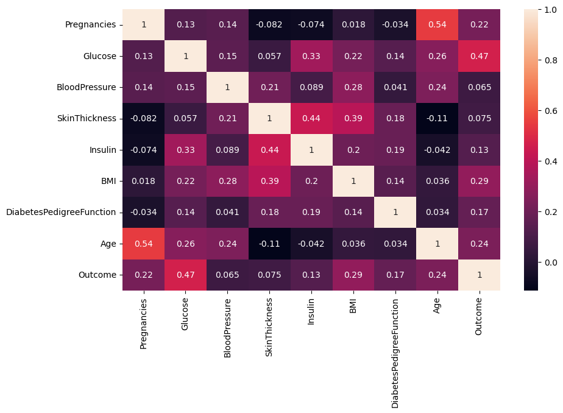
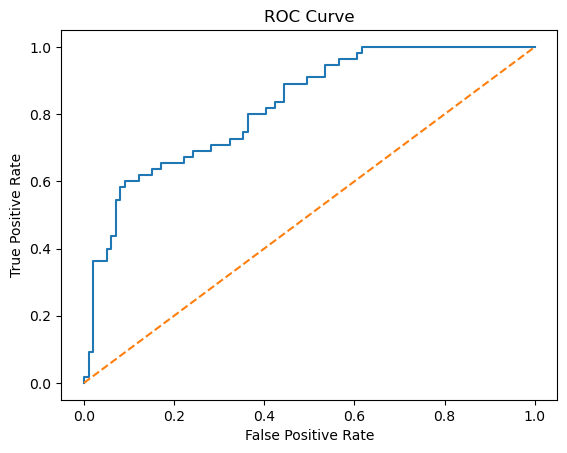
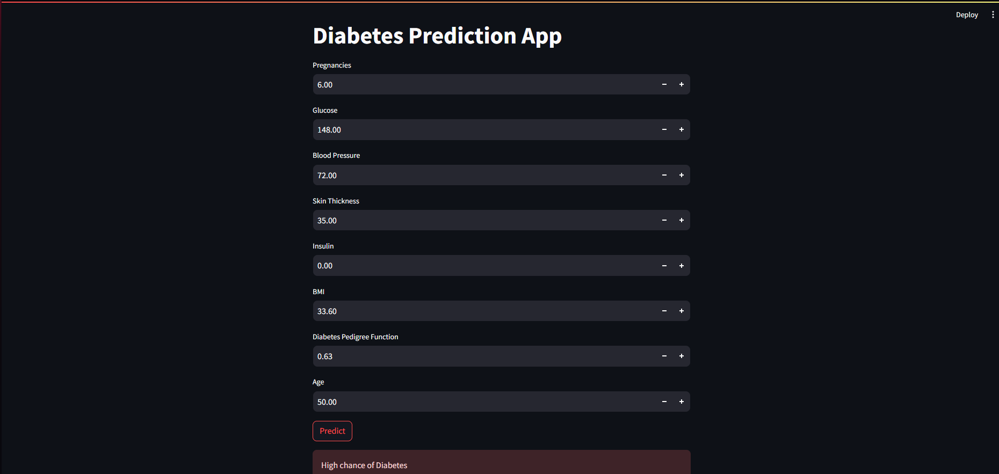

# Diabetes Prediction with Logistic Regression

Logistic regression on 768 patient records to flag patients at higher risk of diabetes, with a small Streamlit app for single-patient predictions.

## Problem

A clinic wants to identify which patients should be sent for further diabetes testing. Can a simple, explainable model do this from routine health measurements, and which measurements matter most?

## Data

- **Source:** Pima Indians Diabetes dataset (public; provided as part of the ExcelR Data Science programme)
- **Size:** 768 rows, 9 columns, 24 KB (`data/diabetes.csv`)
- **Target:** `Outcome` (1 = diabetic, 0 = not diabetic); about 35% of patients are diabetic
- **Features:** Pregnancies, Glucose, BloodPressure, SkinThickness, Insulin, BMI, DiabetesPedigreeFunction, Age
- No missing values are recorded, but several columns contain zeros that are not possible in practice (for example, Insulin is 0 for at least a quarter of patients).

## Approach

1. Explored distributions, outliers and correlations (histograms, box plots, heatmap).
2. Treated zeros in Glucose, BloodPressure, SkinThickness, Insulin and BMI as missing and filled them with the column median.
3. Split the data 80/20 into train and test sets (`random_state=42`) and standardised the features.
4. Trained a logistic regression model.
5. Evaluated it with accuracy, precision, recall, F1, ROC-AUC and a ROC curve.
6. Interpreted the coefficients.
7. Saved the model and scaler with pickle and built a Streamlit app that takes the 8 measurements as input.

## Key results

Test set: 154 patients (99 not diabetic, 55 diabetic).

| Metric | Not diabetic (0) | Diabetic (1) |
|---|---|---|
| Precision | 0.80 | 0.69 |
| Recall | 0.85 | 0.62 |
| F1 score | 0.82 | 0.65 |

- **Accuracy:** 0.766.
- **ROC-AUC:** 0.823 (from predicted probabilities). The original notebook calculated it from predicted classes, which gives 0.733; the corrected cell was added later.
- **Coefficients (features standardised, so they are comparable):**
  - Glucose 1.10, BMI 0.69, Age 0.39, Pregnancies 0.22, DiabetesPedigreeFunction 0.20.
  - BloodPressure −0.15, Insulin −0.14 and SkinThickness 0.07 have little effect.
- **Glucose had the strongest correlation with the outcome** in the heatmap.





## Business takeaway

- **Glucose is the key screening signal,** followed by BMI and age. A short checklist of three measurements carries most of the information.
- **The model catches 62% of diabetic patients in the test set,** so it misses about 4 in 10. For screening, where missing a patient is costly, the decision threshold should be lowered to catch more cases, accepting more false alarms.
- **The model is explainable:** each coefficient shows the direction and relative strength of a risk factor. That makes it easy to discuss with non-technical staff.

## What I learned

- **Zeros can be missing data in disguise.** Zeros in medical measurements are not real readings and have to be treated as missing.
- **Scaling matters for logistic regression.** It keeps features on large scales from dominating, and it makes coefficients comparable.
- **Precision and recall answer different questions.** In screening, recall on the diabetic class matters more than overall accuracy.
- **What I would do differently:**
  - Fit the scaler on the training data only and reuse it for the test data. The notebook refits it on the test set, so the saved `scaler.pkl` used by the app was fitted on the 154 test rows.
  - Calculate ROC-AUC from predicted probabilities (`y_prob`) from the start. The original cell used predicted classes (0.733); a corrected cell now gives 0.823.
  - Fill missing values after the train-test split, using training-set medians.
  - Use cross-validation and tune the decision threshold for higher recall.

## Streamlit app

The app takes the 8 health measurements and returns "High chance" or "Low chance" of diabetes. Example: patient 1 in the dataset (diabetic) is flagged as high chance.



## Tools

Python, pandas, NumPy, Matplotlib, Seaborn, scikit-learn, Streamlit, Jupyter Notebook

## How to run

```bash
git clone https://github.com/manav-atha/diabetes-prediction-logistic-regression.git
cd diabetes-prediction-logistic-regression
pip install -r requirements.txt
jupyter notebook notebooks/diabetes-prediction-logistic-regression.ipynb
```

Run the Streamlit app:

```bash
streamlit run app/app.py
```

## Folder structure

```
diabetes-prediction-logistic-regression/
├── app/
│   ├── app.py
│   ├── model.pkl
│   └── scaler.pkl
├── data/
│   └── diabetes.csv
├── images/
│   ├── app-screenshot.png
│   ├── correlation-heatmap.png
│   └── roc-curve.png
├── notebooks/
│   └── diabetes-prediction-logistic-regression.ipynb
├── requirements.txt
└── README.md
```
